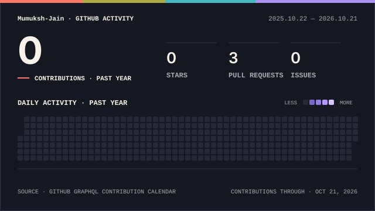

<!-- Mumukshu Jain | original animated GitHub portfolio layout, refreshed October 2026. -->

<div align="center">

<!-- Controlled hero: no auto-generated repository language chips. -->


<a href="https://github.com/Mumuksh-Jain"></a>

<p><strong>Full Stack Developer (MERN) · AI-Integrated Product Builder</strong></p>

<br/>

<a href="https://linkedin.com/in/mumukshu-jain-07484a331">
  
</a>
<a href="https://github.com/Mumuksh-Jain">
  
</a>
<a href="mailto:mumukshujain2466@gmail.com">
  
</a>
<a href="https://leetcode.com/u/gD3rUL0Dta/">
  
</a>

<br/><br/>


</div>

---

## ⚡ About Me

```javascript
const mumukshu = {
  role: "Full Stack Developer | AI Product Builder",
  university: "Chandigarh University | CSE (AI/ML) | 2028",
  experience: "Full Stack Developer Intern @ CodeAlpha",
  buildingWith: ["React", "Node.js", "Express", "MongoDB", "Python"],
  testingWith: ["Postman", "GitHub Actions", "Docker"],
  appliedAI: ["Sentence-Transformers", "Groq Llama 3", "Naive Bayes"],
  exploring: ["RAG", "Agentic AI", "System Design", "Federated ML"],
  highlight: "AI Nexus Hackathon | Top 50 of 200+ teams",
  teamProjects: ["SAS Talent Orbit", "Dogfood Hackathon Platform"],
  research: "Email Spam Detection | Naive Bayes | 93%+ accuracy",
  leetcode: "100+ problems | Primarily C++",
  openTo: ["Software Development", "Full Stack", "AI/ML Internships"]
};
```


---

## 🛠️ Tech Stack

<!-- One consistent icon grid. Avoid mixing eight independently sized animated icons. -->
<p align="center">
  
</p>

| Area | Technologies and skills |
|:--|:--|
| **Web & Backend** | React, JavaScript, Node.js, Express, REST APIs, Flask |
| **Databases & Security** | MongoDB, MySQL, field indexing, JWT authentication, HTTP-only cookies, RBAC |
| **Development & Delivery** | Git, GitHub, Docker, GitHub Actions, CI/CD, Vercel, Render |
| **AI, Data & Testing** | Python, Sentence-Transformers, cosine similarity, Groq Llama 3, Naive Bayes, Pandas, NumPy, Postman API testing |
| **Problem-Solving** | C++ (DSA), data structures and algorithms, debugging |

<details>
<summary><b>🧠 AI / Machine Learning — areas I'm learning</b></summary>

- **ML & evaluation:** regression, classification, decision trees, KNN, K-means, Random Forest, AdaBoost, XGBoost, K-fold/stratified cross-validation, precision, recall, F1 and confusion matrices.
- **Data workflows:** missing values, duplicate handling, encoding, normalization, standardization and visual analysis.
- **Advanced coursework:** federated and distributed ML, parameter servers, peer-to-peer learning, data/model parallelism, Bayesian networks, probabilistic graphical models, RBMs and fuzzy rule-based systems.
- **Generative AI:** RAG, context engineering, tokenization, context windows, CrewAI, Ollama and local LLM concepts.

*Hands-on work is shown in my projects below; the remaining topics reflect coursework and self-study.*
</details>

<details>
<summary><b>🏗️ System Design — concepts I'm exploring</b></summary>

- **Scalability:** vertical and horizontal scaling, capacity estimation and caching with Redis.
- **Messaging & serverless:** AWS SQS, SNS, Lambda, acknowledgements and asynchronous workflows.
- **Architecture:** CQRS, event sourcing and containerization fundamentals.
- **Rate limiting:** token bucket, leaky bucket, fixed window, sliding-window log and sliding-window counter.

*Conceptual knowledge; not a claim of production implementations.*
</details>


---

## 🚀 Featured Projects

<p align="center">
  
</p>

<!-- Use HTML inside HTML tables. Markdown headings, lists and badges do not reliably render inside raw <td> blocks. -->
<table>
  <tr>
    <td width="50%" valign="top">
      <h3>🔍 TraceIt</h3>
      <p><em>AI-powered semantic lost &amp; found platform</em></p>
      <p><a href="https://trace-it-nu.vercel.app"></a> <a href="https://github.com/Mumuksh-Jain/TraceIt"></a></p>
      <ul>
        <li>Semantic matching using Sentence-Transformers, vector embeddings and cosine similarity.</li>
        <li>JWT authentication with token rotation and HTTP-only cookies.</li>
        <li>Docker containerization and automated CI/CD deployment.</li>
      </ul>
      <p><code>React</code> <code>Node.js</code> <code>Express</code> <code>MongoDB</code> <code>Python</code> <code>Flask</code> <code>Docker</code> <code>JWT</code></p>
    </td>
    <td width="50%" valign="top">
      <h3>🤝 CollabHub</h3>
      <p><em>AI-powered developer collaboration platform</em></p>
      <p><a href="https://capstone-full-stack.vercel.app/"></a> <a href="https://github.com/Mumuksh-Jain/Capstone_FullStack"></a></p>
      <ul>
        <li>Groq Llama 3 integration for AI-assisted developer matching and profile enhancement.</li>
        <li>JWT authentication and role-based access control (RBAC).</li>
        <li>Express middleware and MongoDB field indexing for backend queries.</li>
      </ul>
      <p><code>React</code> <code>Node.js</code> <code>Express</code> <code>MongoDB</code> <code>Groq</code> <code>JWT</code> <code>RBAC</code></p>
    </td>
  </tr>
</table>

<table>
  <tr>
    <td width="50%" valign="top">
      <h3>🪐 SAS BFB Talent Orbit</h3>
      <p><em>Hired Is Not Rewarded — AI/ML talent-market decision engine</em></p>
      <p>
        <a href="https://github.com/Mumuksh-Jain/SAS_BFB_TALENT_ORBIT"></a>
        <a href="https://github.com/Mumuksh-Jain/SAS_BFB_TALENT_ORBIT#readme"></a>
      </p>
      <ul>
        <li>Team-built <strong>three-model</strong> ML engine comparing external hiring demand with workplace rewards; analysed <strong>15,841 job postings</strong>.</li>
        <li>Interactive <strong>Streamlit</strong> dashboard and <strong>FastAPI</strong> inference endpoints for interpretable predictions and model comparison.</li>
        <li><strong>34/34 validation checks passed</strong>; model card, calibration, ethical constraints and reproducible reports.</li>
      </ul>
      <p><code>Python</code> <code>Scikit-learn</code> <code>Statsmodels</code> <code>Pandas</code> <code>Streamlit</code> <code>FastAPI</code></p>
      <p><sub>SAS Viya procedures documented as planned, not executed.</sub></p>
    </td>
    <td width="50%" valign="top">
      <h3>🧪 Dogfood 2026</h3>
      <p><em>Offline-first, auditable hackathon management platform</em></p>
      <p>
        <a href="https://github.com/Mumuksh-Jain/dogfood"></a>
        <a href="https://github.com/Mumuksh-Jain/dogfood#readme"></a>
      </p>
      <ul>
        <li>Team hackathon portal for registrations, teams, immutable submissions and role-aware participant/judge workflows.</li>
        <li>Deterministic judge allocation, versioned weighted rubrics, <strong>z-score normalization</strong> and explainable results.</li>
        <li>Independent <strong>SHA-256 replay verification</strong>, CSV export safeguards, and <strong>7/7 acceptance-harness passes</strong>.</li>
      </ul>
      <p><code>Go</code> <code>SQLite</code> <code>REST API</code> <code>Docker</code> <code>SHA-256</code> <code>Offline-First</code></p>
      <p><sub>Go is the project's implementation language; not listed as a personal proficiency claim.</sub></p>
    </td>
  </tr>
</table>

<!-- No Live Demo badge for Talent Orbit or Dogfood: no verified hosted demo URL supplied. -->


---

## 📊 GitHub Stats & Contribution Activity

<!-- The card below is generated and committed by .github/workflows/profile-activity.yml. -->
<!-- Static SVGs are served by GitHub itself: no third-party runtime stats API. -->
<div align="center">
  <picture>
    <source media="(prefers-color-scheme: dark)" srcset="./profile/signal-field-wide-dark.svg" />
    <source media="(prefers-color-scheme: light)" srcset="./profile/signal-field-wide-light.svg" />
    
  </picture>
  <p><a href="https://github.com/Mumuksh-Jain?tab=overview"><strong>View full GitHub contribution history →</strong></a></p>
</div>

---

## 🎖️ Achievements

<table>
  <tr><th align="left" width="24%">Milestone</th><th align="left">Highlight</th></tr>
  <tr><td><strong>🏅 Hackathon</strong></td><td><strong>AI Nexus — Top 50 among 200+ teams</strong> · DecisionX AI (LLM hallucination-evaluation prototype)</td></tr>
  <tr><td><strong>🔬 Research</strong></td><td><em>Email Spam Detection using Naive Bayes</em> · 93%+ reported accuracy · Research manuscript</td></tr>
  <tr><td><strong>💼 Internship</strong></td><td>Full Stack Developer Intern at CodeAlpha · June 2026 – Present</td></tr>
  <tr><td><strong>🚀 Projects</strong></td><td>TraceIt &amp; CollabHub (deployed apps) · SAS Talent Orbit (34/34 checks) · Dogfood (7/7 harness passes)</td></tr>
  <tr><td><strong>🧩 DSA</strong></td><td>100+ LeetCode problems · Arrays, Trees, Graphs, Dynamic Programming and Sliding Window</td></tr>
</table>

---

## 💻 LeetCode

<div align="center">


</div>


---

<div align="center">


<br/><br/>


<br/>


</div>
